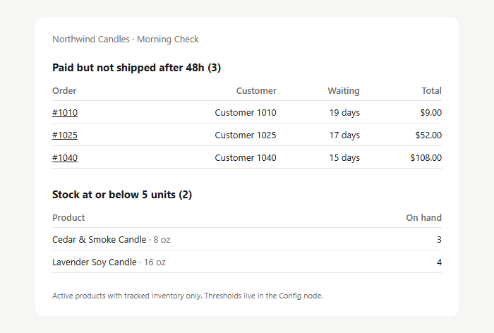

# Shopify Morning Check: free n8n workflow

One email every morning with the two lists that cause most "where is my order?" tickets and lost sales:

- **Paid orders that still haven't shipped** after 48 hours, oldest first, each linked to the order in your admin
- **Variants at or below 5 units** (tracked inventory, active products only)



Works with n8n 2.0+ (Cloud or self-hosted) and the **2026 Shopify Dev Dashboard apps**. Since January 2026 you can't create admin custom apps with a permanent token anymore, so this workflow gets a fresh token on every run with the client-credentials grant. Nothing to renew by hand.

## Setup (about 5 minutes)

### 1. Create the Shopify app
1. Open `dev.shopify.com/dashboard` logged in as the store owner → **Apps → Create app**.
2. App URL: leave `https://example.com`. **Uncheck** "Embed app in Shopify admin".
3. Scopes, comma-separated on one line:
   ```
   read_orders,read_products,read_inventory
   ```
   The app is read-only. It can't change orders, products or prices.
4. **Create app**, then **Install app** on your store.
5. **App settings → Credentials**: copy the Client ID and Client secret.

### 2. Import the workflow
1. In n8n: **Create workflow → ⋯ → Import from file…** and pick `shopify-morning-check.json`.
2. Open **Config** and set `shop_domain` (the `.myshopify.com` address) and `email_to`.

### 3. Connect accounts
- **Get Shopify access token** → *Connect to Custom Auth* → paste into the JSON field:
  ```json
  {
    "body": {
      "client_id": "PASTE_CLIENT_ID",
      "client_secret": "PASTE_CLIENT_SECRET"
    }
  }
  ```
  The body is sent as JSON on purpose: with form-urlencoded, n8n drops the credential's body fields.
- **Send email (Gmail)** → sign in with Google.

### 4. Run it
Click **Execute workflow**. The email should arrive in a few seconds. Then **Publish** and it runs every day at 7:00 (your n8n time zone).

## Settings (Config node)

| Setting | Default | What it does |
|---|---|---|
| `stuck_after_hours` | 48 | Paid orders older than this that are unfulfilled or partly shipped |
| `low_stock_threshold` | 5 | Variants with this many units or fewer |
| `api_version` | 2026-07 | Shopify Admin API version |

## Troubleshooting

| Error | Fix |
|---|---|
| `application_cannot_be_found` | The Client ID in the credential is wrong or still the placeholder |
| `shop_not_permitted` / `invalid_client` | Check the ID/secret, and that the app was created by the store owner's organization and installed |
| Missing access scope | Add the three scopes, release a new version, approve the update on the store |

## How it works

Every step is a native n8n node, so you can see and change it on the canvas:

1. **Get Shopify access token**: fresh token on every run (client-credentials grant).
2. **Get stuck orders** and **Get low-stock variants**: two Admin GraphQL calls (up to 100 results each), retried on failure.
3. **Shopify error?**: stops the run with a clear message if Shopify returns an error (for example a missing scope).
4. **Build the report**: keeps tracked, active, in-stock variants and works out how long each order has waited.
5. **Anything to report?**: quiet days send no email.
6. **Email template** (HTML node) and **Send email (Gmail)**: an inline-styled email that looks right in Gmail and Outlook.

---

Free under the MIT license. Made by [QuietOps](https://github.com/QuietOpsHQ). The full *Shopify Morning Briefing* adds yesterday's sales vs. the same weekday last week, a stock-out forecast from sales velocity, refund spikes, top products and an optional AI summary: [quietopshq.gumroad.com](https://quietopshq.gumroad.com/l/shopify-morning-briefing)
